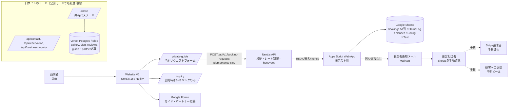
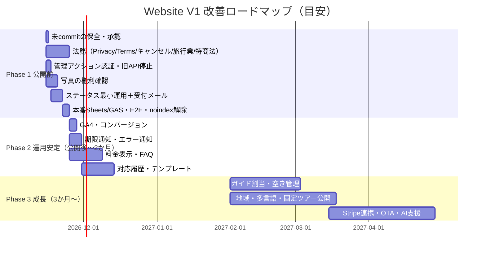
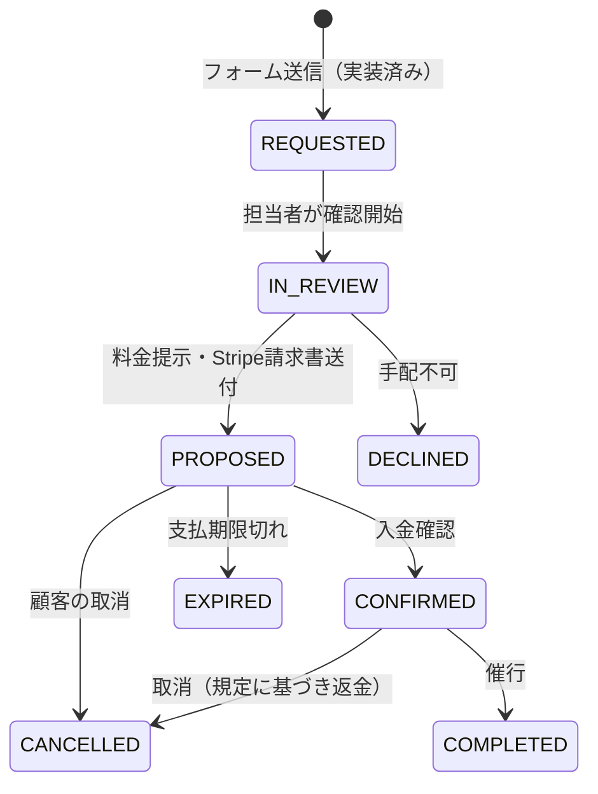

# Connectrip Japan｜Website V1 総合システム監査レポート

- 監査日：2026-11-14
- 対象：`/Users/soma/Projects/Connectrip/worktrees/claude-website-v1`（branch `claude/website-v1-launch`、HEAD `e05a98b`）
- 方法：コード・設定・Apps Script・SQL・仕様書（Obsidian `04_TRAVEL/Website v1`）の読み取り、既存テストの実行、ローカルサーバーへの GET のみ
- 実施していないこと：コード変更、フォーム送信、メール送信、外部サービスへの書き込み、本番環境・Google Sheets・Netlify 管理画面の閲覧
- 秘密値・個人情報は記載していません（環境変数は「設定済みかどうか」のみ）

---

## 1. 結論

**今のままでは公開できません。** 予約リクエストの受付部分は丁寧に作られていますが、それを事業として運営するための「法務表示」「本番環境」「受付後の運用」がまだ整っていません。

| 項目 | 結果 |
|---|---|
| **総合スコア** | **53 / 100**（8領域の等ウェイト平均） |
| 調査で確認できた割合 | 約 74%（残りは本番環境・Google 側・法務など外部確認が必要） |
| 公開判定 | **公開不可**（P0 が 6 件） |
| P0（公開前に必須） | **6 件** |
| P1（早急に改善） | **10 件** |
| 最大のリスク | 個人情報を集めるフォームがあるのに、公開モードの Privacy Policy・Terms が**見出しだけの空ページ**。キャンセル規定は旧サイトの内容（USD デポジット・手配料）のままで、V1 の予約方式と矛盾している |
| 次に設計すべき最重要項目 | **予約リクエストの受付後の運用フロー**（ステータス遷移と顧客への連絡） |

> 点数は「予約受付の技術部分が強く、運営・法務・計測が弱い」という偏りを平均したものです。平均点で安心しないでください。P0 が 1 件でも残っていれば公開不可です。

---

## 2. 現在の総合評価（Scorecard）

| # | 領域 | スコア | 判定 | 確認率 | 一言 |
|---|---|---:|---|---:|---|
| 01 | 事業・サービス設計 | **47** | 運用上の問題が出やすい | 80% | ルールは明確。料金・キャンセル・規約が未確定 |
| 02 | 予約・問い合わせ設計 | **70** | 一部重要な不足 | 85% | 受付・二重送信対策は優秀。受付後の状態管理がない |
| 03 | 顧客・業務運営管理 | **42** | 運用上の問題が出やすい | 65% | Sheets に保存と通知まで。その後の管理手段がない |
| 04 | セキュリティ | **63** | 一部重要な不足（**P0 あり**） | 85% | 予約 API は堅い。旧管理画面に認証なしの操作が残る |
| 05 | システム・データ設計 | **76** | 基本設計は良好 | 85% | 契約型の設計と冪等性が良い。旧サイトのコードが同居 |
| 06 | SEO・AIO・マーケティング | **47** | 運用上の問題が出やすい | 70% | メタ情報は良い。計測ゼロ、公開コンテンツが少ない |
| 07 | 公開・運用準備 | **33** | 重大な不足 | 55% | 本番環境・法務表示・監視・画像権利が未整備 |
| 08 | 事業拡張性 | **48** | 運用上の問題が出やすい | 75% | 地域・商品は追加しやすい。ガイド管理・多言語は未着手 |
| | **総合** | **53** | | **約 74%** | (47+70+42+63+76+47+33+48) ÷ 8 = 53.25 |

```
01 事業・サービス設計   ███████████████████████▌                           47
02 予約・問い合わせ      ███████████████████████████████████                70
03 業務運営管理         █████████████████████                              42
04 セキュリティ         ███████████████████████████████▌                   63  ⚠P0
05 システム・データ      ██████████████████████████████████████             76
06 SEO・計測            ███████████████████████▌                           47
07 公開・運用準備        ████████████████▌                                  33
08 事業拡張性           ████████████████████████                           48
```

---

## 3. できている部分

1. **予約リクエストの受付処理は本番品質に近い**
   - ブラウザ → Next.js → Apps Script → Google Sheets の 3 層すべてで同じ予約ルール（Booking Rules V1.1：4/6/8 時間、08:00〜17:00 開始、20:00 終了、48 時間前締切、90 日先まで、最大 6 名）を検証している（`src/lib/booking-request/rules.ts`、`apps-script/booking-requests/Code.gs:323-367`）
   - 二重送信対策：`submissionId`（UUID v4）＝ `Idempotency-Key`、本文ハッシュ、ロック内での重複確認、結果不明時の 1 回だけの再確認（`src/lib/booking-request/submit.ts:41-68`、`Code.gs:216-256`）
   - Apps Script との通信は HMAC-SHA256 署名＋タイムスタンプ＋nonce（再送防止）（`src/lib/booking-request/gas.ts:58-96`、`Code.gs:147-193`）
   - 料金・金額をクライアントから受け取らない（`rules.ts:171-177`）。スプレッドシートの数式注入対策あり（`Code.gs:565-569`）
   - 管理者通知メールに個人情報を書かない（`Code.gs:628-655`）
   - 既存テスト `bun run check:booking` は今回も PASS
2. **「予約リクエスト ≠ 予約確定」が画面で一貫している**（受付番号表示、「まだ確定ではありません」、Stripe 請求 → 入金後に確定、の 4 ステップ表示）
3. **公開モードの制御が厳格**：公開するのは 7 ページだけ（`src/website-v1/routes.ts:21`）、未確定（TBD）の内容・DEMO 記事・権利未確認の一部写真は公開時に出さない仕組み
4. **SEO の基本**：公開ページごとの title / description / canonical / OG、sitemap、robots、Organization・WebSite・Breadcrumb の構造化データ（`src/website-v1/metadata.ts`、`structuredData.ts`）
5. **設計資料が充実**：仕様（Obsidian）とコード内コメントが対応しており、決定事項（W1-D24 など）が追跡できる

---

## 4. 不足している部分

| 分類 | 不足 |
|---|---|
| 法務 | Privacy Policy・Terms が空、キャンセル規定が V1 と矛盾、旅行業登録の扱いと特定商取引法表記が未確認 |
| 本番 | 予約の保存先が「Connectrip Traveler Bookings (Test)」のまま。本番用 Sheets・Apps Script・環境変数が未準備。フォームからの E2E 実機確認の記録なし |
| 運営 | 状態は `REQUESTED` しか作られない。`status` 列は保護されていて、運営者が状態を進める手段がない。顧客への受付メールがない。回答期限の通知がない |
| セキュリティ | 旧管理画面の一部サーバーアクションに認証がない。旧問い合わせ API にスパム対策がない。管理画面は共有パスワード 1 つ |
| 計測 | V1 に GA4 / GTM が入っていない。問い合わせ・予約リクエストのコンバージョンを測れない |
| 監視 | エラー監視・通知がない。Apps Script の失敗はログに残るだけ |
| 資産 | Hero の 12 枚を含む写真が権利「NOT_VERIFIED」のまま公開ページに出る |
| 保全 | 作業の大部分が未 commit（変更 9 ファイル＋未追跡 20 か所以上） |

---

## 5. 最大のリスク

**「予約を受け付けたあとに、法的にも運営的にも約束を守れないこと」** です。

- 顧客は「Privacy Policy に同意」にチェックして送信しますが、そのページは空です（個人情報保護法上の説明義務。**専門家確認待ち**）
- 支払い・キャンセルのルールを顧客に示せないまま請求することになり、トラブル時の根拠がありません
- 受付後は Sheets に行が増えるだけで、「誰が・いつまでに・何をしたか」を記録する手段がありません。「2 営業日以内に返信」という画面上の約束を守れているか、確認できません

---

## 6. Risk Matrix（事業への影響 × 発生可能性）

```
影響 ▲
 大  │ [P0-3 管理操作の無認証] │ [P0-4 本番環境未準備]      │ [P0-1 規約・Privacy 空]
     │ [P0-5 旅行業の表示]     │ [P0-6 画像権利]            │ [P0-2 キャンセル規定矛盾]
     │                         │                            │ [P1-1 状態管理なし]
 中  │ [P1-4 管理画面の認証]   │ [P1-3 旧APIスパム]          │ [P1-2 受付メールなし]
     │ [P1-8 noindex残り]      │ [P1-6 監視なし]            │ [P1-5 計測なし]
     │                         │ [P1-9 未commit]            │ [P1-7 期限通知なし] [P1-10 料金非表示]
 小  │ [P2 セキュリティヘッダー]│ [P2 レート制限の限界]       │ [P2 公開コンテンツ不足]
     └─────────────────────────┴────────────────────────────┴──────────────────────────▶
          低い                       中くらい                        高い（ほぼ確実）   発生可能性
```

右上（影響大・ほぼ確実）に法務と運営の問題が集中しています。技術的な脆弱性は左側（起きる可能性は低いが、起きると大きい）です。

---

## 7. System Architecture（実装されている構成のみ）



点線は**システムではなく人の作業**です。顧客への受付メール、ステータス更新、Stripe 連携、ガイド割り当ての仕組みは存在しません。

---

## 8. Reservation Journey（予約確定までの流れ）

| # | 段階 | 状態 | 根拠 |
|---|---|---|---|
| 1 | サイトを見つける（検索・SNS） | 部分実装 | メタ・sitemap あり。計測なし、公開コンテンツ 7 ページ |
| 2 | Private Guide の内容を理解する | 部分実装 | ルール・流れは明確。**料金が表示されない**、紹介文・FAQ が TBD |
| 3 | 規約・キャンセル・Privacy を確認 | **未実装** | 公開時に Privacy / Terms は空、キャンセル規定は旧内容 |
| 4 | フォームに入力・送信 | 実装済み | 3 層検証、二重送信対策 |
| 5 | 受付番号の表示 | 実装済み | `CR-YYYYMMDD-XXXXXX`、「まだ確定ではない」表示 |
| 6 | Sheets に保存（REQUESTED） | 実装済み（テスト環境） | API → GAS → Sheets の実機 7/7 PASS（仕様書の記録、2026-11-11） |
| 6' | 本番環境での保存 | **要確認** | 本番 Sheets / GAS 未準備。フォームからの E2E 記録なし |
| 7 | 顧客に受付メール | **未実装** | 管理者通知のみ |
| 8 | 運営に通知 | 実装済み | `Config` シートの宛先設定に依存（**要確認**） |
| 9 | 空き確認・ガイド手配（in_review） | **未実装** | 状態・担当・ガイド割当の仕組みなし（列だけ存在） |
| 10 | 見積・Stripe 請求書送付（proposed） | **未実装**（手動運用前提） | 列 `quoted_amount_jpy`、`stripe_invoice_*` はあるが更新手段なし |
| 11 | 入金確認 → 確定（confirmed） | **未実装** | `paid_at`、`confirmed_at` 列は保護対象、更新処理なし |
| 12 | お断り（declined）・取消（cancelled）・返金 | **未実装** | 状態なし。キャンセル規定も未確定 |

### 状態モデルの検証（received → in_review → proposed → confirmed / declined / cancelled）

| 状態（監査指定） | 実装上の対応 | 区分 |
|---|---|---|
| received | `REQUESTED`（`Code.gs:245`、`src/contracts/bookingRequest.ts:85`） | **実装確認済み** |
| in_review | なし | **未実装と確認** |
| proposed | なし（列 `quote_sent_at` / `stripe_invoice_*` のみ） | **未実装と確認** |
| confirmed | なし（列 `confirmed_at` のみ）。別の型 `PrivateGuideBookingStatus`（`src/contracts/privateGuide.ts:108-112`、旧 Book Now 方式）は使われていない | **仕様書のみ確認** |
| declined / cancelled | なし（列 `refund_status` のみ）。Payment Flow 仕様に `expired / cancelled / refunded` の記述 | **仕様書のみ確認** |

さらに、`status` 列は「直接編集すると元に戻す」保護対象です（`Code.gs:79-95`、`672-683`）。この保護トリガーが本番で有効なら、**運営者は状態をまったく進められません**（トリガーの設置有無は**外部確認が必要**）。

---

## 9. 領域別の採点詳細

凡例：✅実装確認済み　📄仕様書のみ確認　❌未実装と確認　❓確認不能　🌐外部確認が必要　／ 確信度：高・中・低

### 01. 事業・サービス設計 — 47 / 100

| 評価項目 | 配点 | 得点 | 区分 | 確信度 | 根拠 |
|---|---:|---:|---|---|---|
| サービス定義（PG と固定ツアーの区分） | 15 | 11 | ✅ | 高 | Booking Rules V1.1 は APPROVED（W1-D24）。固定ツアーはプレビュー専用で公開範囲外 |
| 顧客の選択項目 | 10 | 9 | ✅ | 高 | 時間・開始・人数・エリア・興味・第2希望 |
| 料金設定と表示 | 15 | 5 | ✅ | 高 | PG は「返信時に価格を提示」で料金非表示（`content/privateGuide.ts:58-60`）。5〜6名の価格区分 U-2 未決。大阪ツアー料金はプレビューのみ |
| 税・追加費用 | 10 | 5 | ✅ | 中 | ツアーは税込・Not Included 記載。PG の交通費・入場料などの扱いは未記載 |
| キャンセル条件 | 15 | 2 | ✅ | 高 | 公開ページは旧サイトの規定（USD 300 デポジット、手配料）（`content/currentSitePages.ts:56-70`）。フォーム内は TBD（`content/privateGuideRequest.ts:201`）。U-6 未解決 |
| 利用規約・重要事項 | 15 | 4 | ✅ | 高 | Terms / Privacy の本文が TBD（`content/pages.ts:113-127`）。フォーム内の Key Terms は良い |
| 法的に提供可能な範囲 | 10 | 3 | 🌐 | 低 | 会社概要に「パッケージツアーの企画・販売」「宿泊・交通の手配」と記載、登録番号の表示なし。**専門家・行政確認待ち** |
| 将来のサービス追加の容易さ | 10 | 8 | ✅ | 中 | contracts / content / views 分離、`productType` に ready_made 枠あり |

### 02. 予約・問い合わせ設計 — 70 / 100

| 評価項目 | 配点 | 得点 | 区分 | 確信度 | 根拠 |
|---|---:|---:|---|---|---|
| フォーム・入力項目 | 10 | 9 | ✅ | 高 | `PrivateGuideRequestForm.tsx` |
| バリデーション（3 層） | 15 | 14 | ✅ | 高 | `rules.ts`、`Code.gs:323-367`、テスト PASS |
| 受付と確定の区別 | 10 | 10 | ✅ | 高 | 受付画面の文言、`status: "REQUESTED"` 固定 |
| 二重送信対策・冪等性 | 15 | 14 | ✅ | 高 | `submit.ts`、`Code.gs:216-256`、送信中は fieldset 無効化 |
| ステータス管理 | 15 | 4 | ❌ | 高 | REQUESTED のみ。遷移処理なし、status 列は保護 |
| 運営への通知 | 10 | 7 | ✅🌐 | 中 | 管理者メールあり（個人情報なし）。宛先設定は Sheets 側 |
| 顧客への受付連絡 | 10 | 3 | ❌ | 高 | 画面の受付番号のみ。メールなし |
| エラー時の処理 | 10 | 9 | ✅ | 高 | 400/409/422/429/503 を区別、「結果不明」は同じ ID で再送 |
| 変更・キャンセル対応 | 5 | 0 | ❌ | 高 | 仕組みなし（問い合わせへ誘導のみ） |

問い合わせ（/inquiry）：公開モードではフォームを出さず SNS リンクのみ（`views/PageViews.tsx:170-200`）。保存・追跡はされません。

### 03. 顧客・業務運営管理 — 42 / 100

| 評価項目 | 配点 | 得点 | 区分 | 確信度 | 根拠 |
|---|---:|---:|---|---|---|
| 問い合わせデータの保存 | 15 | 12 | ✅🌐 | 中 | Bookings 51 列（テスト環境）。本番は未作成 |
| 運営担当者への通知 | 10 | 7 | ✅ | 中 | `Code.gs:628-655` |
| 対応漏れ防止（期限） | 15 | 6 | ✅❌ | 高 | `reply_due_at`（2 営業日、祝日は Config）は計算・保存。期限前の通知なし |
| 問い合わせ詳細の確認 | 10 | 7 | 🌐 | 中 | Sheets を直接見る |
| やり取りの履歴 | 10 | 2 | ❌ | 高 | StatusLog はシステム記録のみ。メールは個人の受信箱 |
| ガイド手配への引き継ぎ | 10 | 2 | ❌ | 高 | `guide_hold*` 列のみ |
| 担当者の割り当て | 10 | 0 | ❌ | 高 | 列なし |
| 確定後の管理 | 10 | 2 | ❌ | 高 | 列はあるが更新手段なし |
| 検索・件数増加への対応 | 10 | 4 | 🌐 | 低 | Sheets のフィルタ頼み |

### 04. セキュリティ — 63 / 100（**P0 あり＝公開不可**）

| 評価項目 | 配点 | 得点 | 区分 | 確信度 | 根拠 |
|---|---:|---:|---|---|---|
| 予約 API の認証・署名 | 15 | 14 | ✅ | 高 | HMAC＋timestamp±5分＋nonce、定数時間比較、宛先ホスト制限 |
| サーバー側バリデーション | 10 | 9 | ✅ | 高 | 文字数・形式・列挙値の制限 |
| Rate Limiting・スパム対策 | 10 | 5 | ✅ | 高 | 予約 API はメモリ内制限＋honeypot（`rate-limit.ts:1-23`）。旧 API は**なし** |
| 管理画面の認証・認可 | 20 | 3 | ✅ | 高 | 認証なしのサーバーアクションあり（P0-3）、共有パスワード（P1-4） |
| 個人情報の保護 | 15 | 9 | ✅🌐 | 中 | 通知に個人情報なし。旧 mailer は SMTP 未設定時に本文をログ出力（`src/lib/mailer.ts:84-85`）。Sheets の共有範囲は外部確認 |
| XSS / CSRF / ヘッダー | 10 | 6 | ✅ | 中 | React のエスケープ、メール HTML エスケープ。CSP・X-Frame-Options などのヘッダーなし（ローカルの応答で確認） |
| 秘密情報の管理 | 10 | 9 | ✅ | 高 | `.env*` は Git 対象外、サーバー側のみで参照、秘密鍵 32 文字以上を要求 |
| 外部連携の安全性 | 10 | 8 | ✅ | 高 | 20 秒タイムアウト、リダイレクト先ホスト制限 |

### 05. システム・データ設計 — 76 / 100

| 評価項目 | 配点 | 得点 | 区分 | 確信度 | 根拠 |
|---|---:|---:|---|---|---|
| 構成と責務分離 | 15 | 13 | ✅ | 高 | contracts → content（view model）→ views、Route Registry |
| API の責務 | 10 | 9 | ✅ | 高 | route は薄く、rules / submit / gas に分離 |
| データモデル | 15 | 9 | ✅ | 中 | 予約は Sheets、旧機能は Postgres の 2 系統。顧客・ガイドの実体なし |
| 整合性（ロック・冪等） | 15 | 13 | ✅ | 高 | ScriptLock 内で確認と書き込み。bookingRef の重複確認はなし（`Code.gs:557-563`、確率は極小） |
| 外部障害への対応 | 10 | 8 | ✅ | 高 | 503・結果不明・1 回だけの再試行 |
| 保守性 | 15 | 10 | ✅ | 中 | 文書は充実。旧サイト（`[locale]`、guide-community、admin）が同居、未 commit の大きな差分 |
| テストしやすさ | 10 | 7 | ✅ | 高 | fetch を注入できる純粋関数 |
| 機能追加の容易さ | 10 | 7 | ✅ | 中 | 契約のバージョン管理（Contract 0.3） |

### 06. SEO・AIO・マーケティング — 47 / 100

コードで確認できる実装のみを採点しています。実際の検索順位・AI 検索での引用は評価していません（保証もできません）。

| 評価項目 | 配点 | 得点 | 区分 | 確信度 | 根拠 |
|---|---:|---:|---|---|---|
| Title / Description / Canonical / OG | 15 | 13 | ✅ | 高 | `metadata.ts:16-60` |
| 見出し構造 | 10 | 7 | ❓ | 中 | 主要ページは H1 あり（全ページの網羅確認はしていない） |
| Sitemap・robots・インデックス制御 | 10 | 7 | ✅🌐 | 中 | 公開 7 ページ。`netlify.toml:20-23` が全ホストに noindex（P1-8） |
| 構造化データ | 10 | 8 | ✅ | 高 | Organization / WebSite / BreadcrumbList |
| 地域・関西のコンテンツ | 20 | 5 | ✅ | 高 | Journal・Travel Guide は DEMO でプレビュー専用 |
| 計測（GA4・コンバージョン） | 20 | 0 | ❌ | 高 | V1 の layout に GTM なし（旧サイトのみ `src/app/[locale]/layout.tsx`） |
| 表示速度 | 10 | 5 | ❓ | 低 | next/image 使用。Lighthouse などの計測は未実施 |
| AI 検索で参照されやすい情報設計 | 5 | 2 | ✅ | 中 | 事実ベースの説明文。FAQ は TBD |

### 07. 公開・運用準備 — 33 / 100

| 評価項目 | 配点 | 得点 | 区分 | 確信度 | 根拠 |
|---|---:|---:|---|---|---|
| 本番環境設定 | 15 | 3 | 🌐📄 | 中 | GAS の対象は Test シート（`Code.gs:5`）。本番準備は STEP 14 で未実施（仕様書） |
| デプロイ構成 | 10 | 6 | ✅ | 中 | `netlify.toml`（プラグインの不具合回避あり） |
| エラーログ・監視 | 15 | 1 | ❌ | 高 | 監視サービスなし。API の catch はログを残さない（`api/v1/booking-requests/route.ts:37-39`） |
| バックアップ・ロールバック | 10 | 4 | 🌐 | 低 | Sheets の版履歴・Netlify の巻き戻しは外部。コードの大部分が未 commit |
| テスト | 10 | 5 | ✅ | 高 | 予約の単体テストのみ。E2E・CI なし |
| 法務表示 | 20 | 3 | ✅🌐 | 高 | Privacy / Terms 空、キャンセル矛盾、特商法表記なし |
| 画像ライセンス | 10 | 2 | ✅ | 高 | 26 か所で `NOT_VERIFIED`。Hero 12 枚は公開時も表示 |
| 公開モードの機能制限 | 10 | 9 | ✅ | 高 | PUBLIC_PATHS、TBD 非表示、DEMO 除外 |

### 08. 事業拡張性 — 48 / 100

| 評価項目 | 配点 | 得点 | 区分 | 確信度 | 根拠 |
|---|---:|---:|---|---|---|
| ツアー数の追加 | 15 | 10 | ✅ | 中 | experiences の型あり。Featured は 1 件固定 |
| 複数地域への拡大 | 15 | 11 | ✅ | 高 | AreaKey（osaka / kyoto / kobe / nara / other）、地域別ガイドの構造 |
| 多言語対応 | 15 | 5 | ✅ | 高 | V1 は英語のみ。予約の locale は 4 言語分を受け付け可 |
| ガイド人数の増加 | 15 | 3 | ❌ | 高 | ガイドの空き・割当の仕組みなし |
| 予約管理機能の拡張 | 15 | 9 | ✅ | 中 | Sheets の列は見積・請求・返金を先取り |
| 外部連携（OTA・体験事業者） | 10 | 3 | ❌ | 高 | 連携なし |
| AI 業務支援の土台 | 15 | 7 | ✅ | 中 | 列挙値で構造化された予約データ |

---

## 10. 問題点一覧

### P0：公開前に必須

#### P0-1 Privacy Policy と Terms が公開時に空
- 現状：本文が TBD。公開モードでは見出しだけが表示される（`src/website-v1/content/pages.ts:113-127`、`src/website-v1/views/PageViews.tsx:231-234`）。フォームは Privacy Policy への同意を必須にしている（`content/privateGuideRequest.ts:194-199`）
- リスク：個人情報の取得目的・第三者提供（Google・Stripe）・保管期間の説明がないまま個人情報を集める
- 顧客への影響：同意の根拠がない、不信感 ／ 社内への影響：苦情・行政指導時に説明できない
- 改善：専門家の確認を受けた本文を作成して承認し、`approved` の値として入れる。Google Sheets・Stripe・メールでの取り扱いを明記
- 影響範囲：/privacy、/terms、フォームの同意文 ／ 難易度：技術は低、法務確認は中
- 依存：法的な提供範囲（P0-5）

#### P0-2 キャンセル規定が V1 の予約方式と矛盾
- 現状：公開ページは旧サイトの規定（USD 300 の相談デポジット、宿泊・交通の手配料など）（`content/currentSitePages.ts:56-70`、`messages/en.json` の cancelPolicy）。フォーム内のキャンセル欄は TBD（`content/privateGuideRequest.ts:201`）。V1 は「JPY の Stripe 請求、全額前払い、24 時間以内に支払い」
- リスク：表示と請求内容が違う → 返金トラブル、カード会社へのチャージバック
- 改善：Private Guide 用の規定（取消料の時期、ガイド都合・天候、無断不参加、返金方法・期間）を決め（U-6）、旧規定を差し替える
- 影響範囲：/cancel-policy、フォーム、Stripe 請求書の説明 ／ 難易度：技術は低、決定は中
- 依存：料金（P1-10）、法務（P0-5）

#### P0-3 旧管理画面のサーバーアクションに認証がない
- 現状：`src/app/admin/(protected)/gallery/actions.ts:7, 38`、`vlog/actions.ts:7, 48`、`reviews/actions.ts:6, 44` は `isAdminAuthenticated()` を呼ばない。画面のレイアウトだけが認証しているが、Next.js のサーバーアクションは画面とは別に呼び出せる（guide-applications と partner-registrations のアクションは正しく認証している）
- リスク：認証なしで公開 Blob への画像アップロード、ギャラリー・Vlog・レビューの追加・削除ができる可能性。公開モードでも `/admin` は proxy の対象外で到達可能（`src/proxy.ts:29`）
- 本番での悪用可能性：本番に `POSTGRES_URL`・`BLOB_READ_WRITE_TOKEN` が設定されているか次第（**外部確認が必要**）
- 改善：各アクションの先頭で認証確認。使っていない旧管理機能は無効化
- 影響範囲：旧サイトの管理機能のみ ／ 難易度：低（数行）

#### P0-4 本番の予約バックエンドが未準備・フォームからの E2E 未確認
- 現状：Apps Script の保存先は「Connectrip Traveler Bookings (Test)」（`apps-script/booking-requests/Code.gs:5`）。本番用 Sheets・Apps Script・Netlify の環境変数は未準備（仕様書 STEP 14）。ウェブのフォームから送った実機テストの記録なし（仕様書 STEP 12 は「未実施」）
- 補足：ローカルの `.env.local` には予約用の URL と秘密鍵が設定済み（値は未確認）。そのため **localhost:3013 のフォームは実際にテスト用 Sheets に書き込む live モード**です
- 改善：本番用 Sheets・Apps Script を作成し、秘密鍵を新しく発行、Netlify に設定、保護トリガーと通知先を設定、本番でフォームから 1 件送信して確認したのちに削除
- 難易度：中 ／ 依存：経営側の承認、P1-1（状態の運用方法）

#### P0-5 旅行業法上の提供範囲と表示（専門家・行政確認待ち）
- 現状：会社概要に「パッケージツアーの企画・販売」「宿泊・交通・体験の手配」、国内旅行業務取扱管理者の記載がある一方、旅行業の登録番号は表示されていない（`messages/en.json` company、`structuredData.ts` は意図的に登録番号を出さない）。オンライン販売に必要な特定商取引法の表記ページもない
- 判断：**コードからは合法性を確定できません**。ガイドサービスのみの提供か、手配を伴うかで必要な登録・表示が変わります
- 改善：行政書士・観光庁窓口などで確認し、会社概要の事業内容を実際の提供範囲に合わせる。必要なら登録番号・特商法表記を追加

#### P0-6 写真の権利が未確認のまま公開ページに出る
- 現状：Hero の 12 枚は `licence: "NOT_VERIFIED"`（`src/website-v1/assets/heroImages.ts:49-51`）だが、公開モードでも表示される（ほかの写真は公開時に隠す仕組みがあるのに、Hero には条件がない）。README も「公開前に権利確認が必要」としている
- 改善：出典・ライセンスを 1 枚ずつ記録して `CONFIRMED_BY_HUMAN` にする。確認できない写真は差し替え
- 難易度：技術は低、確認作業は中

### P1：早急に改善

| ID | 問題 | 根拠 | リスク | 改善方法 | 難易度 |
|---|---|---|---|---|---|
| P1-1 | 受付後のステータス遷移がない（REQUESTED のみ）。status 列は保護されて編集不可 | `Code.gs:79-95, 242-246, 672-683` | 対応漏れ、二重対応、進捗が見えない | Apps Script のメニューで「確認中・提案済み・確定・お断り・取消・期限切れ」に変更し StatusLog に記録（管理画面は作らない） | 中 |
| P1-2 | 顧客への受付メールがない | `api/v1/booking-requests/route.ts`、`Code.gs:628-655` | メール誤入力に気づけない、「届いたか」の問い合わせ増加 | Apps Script から受付確認メール（受付番号・確定ではない旨・返信期限）。送信失敗は受付を止めない | 低〜中 |
| P1-3 | 旧問い合わせ API が公開時も動き、レート制限・honeypot・文字数制限がない | `src/app/api/contact/route.ts`、`reservation/route.ts`、`business-inquiry/route.ts`、`src/proxy.ts:29` | 受信箱へのスパム、SMTP 未設定時は本文をログ出力（`src/lib/mailer.ts:84-85`） | V1 で使わないので `partner-applications` と同じく 410 で閉じる | 低 |
| P1-4 | 管理画面の認証が弱い | `src/lib/admin-auth.ts:6-10, 16-19, 28-38` | 共有パスワード 1 つ、セッション値が固定（パスワードのハッシュ）で失効できない、ログイン試行の制限なし | 当面は強いパスワードとログイン制限。予約管理には使わない | 低〜中 |
| P1-5 | 計測がない（GA4・コンバージョン） | `src/app/v1/layout.tsx`（GTM なし） | 集客施策の効果が分からない | GTM/GA4 を入れ、受付成功（bookingRef 表示）を 1 つのコンバージョンにする。個人情報は送らない | 低 |
| P1-6 | エラー監視・通知がない | `route.ts:37-39`、`Code.gs:653` | 予約が失敗し続けても気づかない | 503 の件数を記録し通知。Apps Script の失敗時に管理者へメール | 低〜中 |
| P1-7 | 返信期限（2 営業日）の通知がない | `Code.gs:571-611`（期限は計算済み） | 画面の約束を破る | 毎朝のトリガーで「期限が近い未対応」を通知 | 低 |
| P1-8 | `netlify.toml` の noindex ヘッダーが全ホストに付く | `netlify.toml:20-23` | 本番ドメインでも静的ファイルが noindex のまま | 本番切り替えのチェックリストに入れ、ホスト条件付きにする | 低 |
| P1-9 | 作業の大部分が未 commit | `git status`（変更 9＋未追跡 20 か所以上） | 消失・どの版を公開したか不明 | 承認を得てローカル commit（push なし）でも保全 | 低 |
| P1-10 | Private Guide の料金が非表示、価格区分（U-2）と子どもの年齢（U-5）が未決 | `content/privateGuide.ts:58-60`、仕様書 | 申し込みの心理的な壁、見積の不一致 | 料金表（時間×人数）を決め、表示するか方針を決める | 決定が中心 |

### P2：次の開発フェーズ

| ID | 問題 | 根拠 |
|---|---|---|
| P2-1 | セキュリティヘッダー（CSP、X-Frame-Options、Referrer-Policy）なし | `next.config.ts:70-78`、ローカル応答 |
| P2-2 | レート制限がインスタンスごとのメモリ内 | `src/lib/rate-limit.ts:1-9` |
| P2-3 | 保護セルの巻き戻しが複数セルの貼り付けで範囲全体を空にする恐れ | `Code.gs:672-683` |
| P2-4 | ローカル開発のフォームがテスト用 Sheets に書き込む | `.env.local`、`app/v1/private-guide/page.tsx:21` |
| P2-5 | E2E テストと CI がない | `package.json`、`.github` なし |
| P2-6 | 公開コンテンツ（Journal・地域ガイド）が少ない | `content/journal.ts`（DEMO） |
| P2-7 | 旧サイトのコード同居による保守負担 | `src/app/[locale]`、`guide-community`、`admin` |

### P3：将来の拡張時

多言語版、ガイドの空き・割当管理、予約管理画面、Stripe の自動連携（webhook）、OTA・体験事業者との連携、AI による返信文の下書き・振り分け。

---

## 11. Improvement Roadmap



| Phase | 期間の目安 | 内容 | 完了の条件 |
|---|---|---|---|
| **1 公開前** | 1〜2 週間 | P0 全件、P1-1・P1-2・P1-3・P1-8・P1-9 | 本番でフォーム → Sheets → 通知 → 受付メールまで 1 件確認、法務ページ承認済み |
| **2 運用安定** | 公開後 1〜2 か月 | 計測、期限・エラー通知、料金表示、対応履歴、管理画面認証の強化 | 全リクエストの状態と返信期限が Sheets で追える |
| **3 成長** | 3 か月〜 | ガイド管理、地域・多言語、固定ツアー公開、Stripe 自動化、外部連携、AI 支援 | 月間件数が Sheets 運用の限界（目安：週 30 件超）に近づいたら着手 |

仕様書では公開目標が **2026-11-15** になっていますが、P0 が残っているため、この日の公開は推奨しません。

---

## 12. Priority Ranking（次に設計すべき TOP 10）

| 順位 | 項目 | この順番の理由 |
|---|---|---|
| 1 | **予約リクエストの運用フロー（状態遷移・担当・期限）** | 請求・確定・キャンセル・計測・ガイド割当のすべてがこの状態を前提にする。ここが決まらないと規約もメールも書けない |
| 2 | キャンセル・返金規定（Private Guide 用） | 1 の「取消・お断り」の扱いを決めると同時に決まる。P0-2 の解消 |
| 3 | Privacy Policy・Terms・特商法・旅行業の表示 | 2 と提供範囲が決まれば書ける。P0-1・P0-5 |
| 4 | 顧客への受付メール | 1 の最初の状態（受付）を顧客に伝える。テンプレートは 2・3 を参照する |
| 5 | 本番環境（Sheets・Apps Script・環境変数）と E2E | 1〜4 が入った状態で構築すれば作り直しが不要 |
| 6 | 旧管理アクションの認証・旧 API の停止 | 作業量が小さく独立しているので、1〜5 と並行できる |
| 7 | 写真の権利確認 | 人の作業。並行可能 |
| 8 | 計測（GA4・コンバージョン） | 公開日から数字を取らないと比較の基準がなくなる |
| 9 | 返信期限・エラーの通知 | 1 の状態があって初めて「未対応」を判定できる |
| 10 | 料金表示と FAQ | 申込率の改善。公開後の問い合わせ内容を見てから決めても遅くない |

---

## 13. 経営判断のための回答

### Q1. 現在の Web サイトは、どの程度完成しているか？
内部設計・運営・予約・集客で見ると **約 5 割（53 点）** です。
- **予約受付の技術**：約 8 割。二重送信対策・署名・3 層検証は小規模事業としては十分以上
- **受付後の運営**：約 4 割。保存と通知までで、その先は人の記憶とメールに頼る
- **法務・公開準備**：約 3 割。規約・キャンセル・本番環境が未整備
- **集客**：約 5 割。SEO の土台はあるが、計測と公開コンテンツがない

### Q2. 現段階で公開を妨げる最大の問題は何か？
**必須条件（P0）**
1. Privacy Policy・Terms が空（P0-1）
2. キャンセル規定が V1 と矛盾（P0-2）
3. 旧管理アクションの無認証（P0-3）
4. 本番の予約環境が未準備・フォームからの E2E 未確認（P0-4）
5. 旅行業法上の提供範囲と表示の確認（P0-5、専門家・行政確認待ち）
6. 公開写真の権利確認（P0-6）

**推奨改善（公開前にできれば入れる）**：ステータスの最小運用（P1-1）、顧客への受付メール（P1-2）、旧 API の停止（P1-3）、noindex の解除確認（P1-8）、未 commit 作業の保全（P1-9）

最大の問題は 1 つに絞るなら **「顧客と交わす約束（規約・Privacy・キャンセル）が未確定なこと」** です。

### Q3. 次に設計すべき機能は何か？
**予約リクエストの受付後の運用フロー**（状態遷移・担当者・返信期限・顧客への連絡）。

推奨する最小の状態モデル：



実装は **Apps Script のメニュー＋StatusLog＋Gmail テンプレート**で十分です。Web の管理画面は作りません。

### Q4. なぜそれを最優先するべきか？
- **事業への影響**：売上は「受付」ではなく「確定」で発生します。今は受付から確定までが記録されず、返信遅れ・請求漏れ・二重手配を防げません
- **依存関係**：キャンセル規定（どの状態から取消料が発生するか）、受付メール（何を約束するか）、計測（どこまで進んだか）、ガイド割当、Stripe 連携、AI 支援のすべてがこの状態モデルを前提にします。先に決めれば、ほかの作業の作り直しを防げます
- **既存資産が活きる**：Sheets の 51 列はすでに見積・請求・入金・返金の列を持っているので、追加するのは「遷移の手段」と「記録」だけです

### Q5. 今は作らなくてもよい機能は何か？
- **Web の予約管理画面**：月数十件までは Google Sheets＋Apps Script メニューで足ります
- **Stripe の自動連携（webhook・自動確定）**：手動請求で回る件数のうちは不要
- **即時予約・空き枠カレンダー**：ガイドの空き管理がないまま作ると誤った確定を生みます
- **多言語版**：英語で需要を確かめてから
- **OTA 連携・体験事業者 API**：商品と運用が固まってから
- **AI による自動返信**：状態とテンプレートが整ってから「下書き支援」として始める
- **データベース移行（Sheets → Postgres）**：件数が Sheets の限界に近づいてから

### Q6. 最短で安全に運用開始するための開発順序は？
1. **今日**：未 commit 作業の保全（承認後にローカル commit）、旧管理アクションの認証、旧 API の停止（小さく独立した作業）
2. **今週**：キャンセル規定と料金方針を決める → Privacy・Terms・特商法の原案 → 専門家確認に出す。並行して写真の権利確認
3. **来週**：状態の最小運用（Apps Script メニュー）と顧客への受付メール
4. **公開直前**：本番 Sheets・Apps Script・環境変数、本番 E2E（1 件送って削除）、noindex 解除、GA4
5. **公開**：法務の承認がそろった時点
6. **公開後 1〜2 か月**：期限・エラー通知、料金表示、FAQ、対応履歴

---

## 14. 技術的根拠（調査範囲）

| 調査項目 | 結果 |
|---|---|
| Git | branch `claude/website-v1-launch`、HEAD `e05a98b`。変更 9 ファイル（+457 / −183 行）、未追跡 20 か所以上。直近の commit に「local safety commit, not for push」 |
| 構成 | Next.js 16.3.2、React 19、Tailwind 4、next-intl（旧サイト）、Netlify（`@netlify/plugin-nextjs`） |
| ルーティング | プレビュー：`/v1/*`。公開：7 ページをルートに書き換え、それ以外は 404（`src/proxy.ts`）。`/api`・`/admin`・`guide-community` は proxy の対象外 |
| API | `/api/v1/booking-requests`（V1 予約）、旧：`contact`・`reservation`・`business-inquiry`（メール送信）、`guide-applications`・`partner-registrations`（Postgres 保存）、`partner-applications`（410 で閉鎖済み） |
| データ | 予約：Google Sheets（Bookings / StatusLog / Nonces / Config）。旧機能：Vercel Postgres（`sql/*.sql`）・Vercel Blob。ローカル代替：`.data/*.json` |
| フォーム | Private Guide：live / mock を秘密鍵の有無で切り替え。Inquiry：公開時は SNS リンク。Business Inquiry：プレビューのみ（モック） |
| メール | V1 予約：Apps Script の MailApp（管理者のみ）。旧：nodemailer（SMTP） |
| 外部連携 | Google Apps Script、Google Sheets、Google Forms（ガイド・パートナー応募）、Stripe（手動、コード連携なし） |
| 環境変数 | `.env.local` に設定済み：`BOOKING_GAS_URL`、`BOOKING_GAS_SECRET`。未設定：SMTP 系、`POSTGRES_URL`、`BLOB_READ_WRITE_TOKEN`、`ADMIN_PASSWORD`、`NEXT_PUBLIC_GTM_ID`。本番（Netlify）の設定状況は**外部確認が必要** |
| 認証 | 予約 API：公開（honeypot・レート制限）、GAS 間は HMAC。管理画面：共有パスワード＋固定 Cookie |
| SEO | title / description / canonical / OG / X、sitemap（公開 7 ページ）、robots（/admin・/api を除外）、JSON-LD 3 種 |
| テスト | `bun run check:booking` PASS（今回実行）、`bun run check:v1-guides` 自己テスト PASS（DEMO 記事はゲートで不合格＝想定どおり）。E2E・CI なし |
| デプロイ | `netlify.toml`（ビルドコマンド・noindex ヘッダー）。本番デプロイは未実施（仕様書） |
| 仕様書 | Obsidian `04_TRAVEL/Website v1`（Booking Rules V1.1、Contract 0.3、Development Status、Decisions and Blockers、Payment Flow など） |
| ローカル確認 | `http://localhost:3013/v1` の応答に CSP・X-Frame-Options などのヘッダーなし。`/admin/login` は 200 |

### この監査の制約
- 本番環境（Netlify の環境変数、本番 Sheets、Apps Script のトリガー・共有設定、Gmail）は見ていません
- フォーム送信・メール送信は行っていないため、ウェブのフォームからの E2E は確認していません
- 表示速度・アクセシビリティの計測は行っていません
- 法的な判断（旅行業法・個人情報保護法・特定商取引法）はしていません。該当箇所は「専門家・行政確認待ち」です
